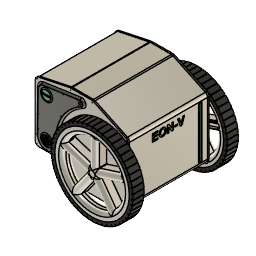

# EON-V mechanical design

Copyright (c) 2026 BrunoCAT23.

The owner-supplied Autodesk Fusion design is in
[`fusion/EON-V.f3d`](fusion/EON-V.f3d). Open it in Autodesk Fusion to inspect
or edit the design. Its embedded preview is shown below.

## License and attribution

The EON-V CAD model and its preview in this directory are licensed under
[Creative Commons Attribution 4.0 International (CC BY 4.0)](https://creativecommons.org/licenses/by/4.0/).
See [LICENSE.md](LICENSE.md) and the
[legal code](https://creativecommons.org/licenses/by/4.0/legalcode.en).
The owner confirmed the choice of license and their rights to the model.
This license is separate from the software's GPL-3.0-only license.

Suggested attribution: **EON-V mechanical design by BrunoCAT23, licensed under
CC BY 4.0**. Include a link to this repository and the license, and identify
your modifications when sharing an adaptation.

The supplied F3D archive is unchanged. The preview was extracted from it;
it is not a separate render or a manufactured prototype photograph.

## Verification and limitations

- Size: 2,598,006 bytes.
- SHA-256: `f408c6d3ea9d7ca1f36f4646a2e985ecea313a482abdba85cdb7ac2449a52e40`.
- Container: 30 entries, 16,604,074 uncompressed bytes, CRC check passed.
- Pattern scan of decompressed contents as UTF-8 text found no API keys,
  email addresses or personal Windows paths.
- Opening in Fusion, geometry, assembly fit and printability have not been
  verified in this publication preparation.

STEP, STL and 3MF exports are not included. Export them from the actual Fusion
design if needed; changing the file extension does not convert the archive.
